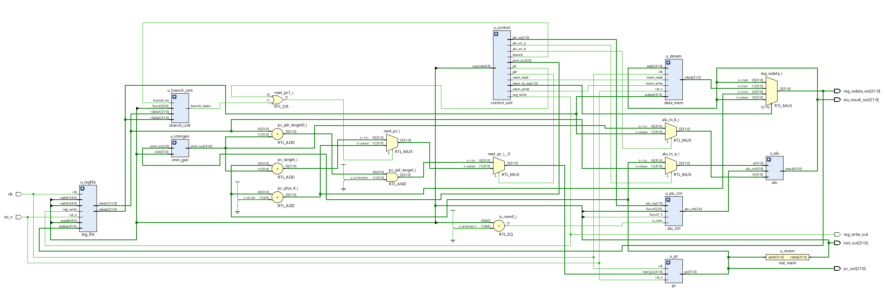

# RV32I RISC-V Processor Core & Layered OOP Testbench

A single-cycle **RISC-V 32-bit Integer (RV32I)** processor core designed in SystemVerilog and verified using a **layered Object-Oriented Programming (OOP) testbench** along with assembly/machine code hex program execution.

Developed and simulated in **AMD Vivado**.

---

## Key Features

- **RV32I Base Integer ISA Support**:
  - **R-type Arithmetic & Logic**: `ADD`, `SUB`, `SLL`, `SLT`, `SLTU`, `XOR`, `SRL`, `SRA`, `OR`, `AND`
  - **I-type Immediate Operations**: `ADDI`, `SLTI`, `SLTIU`, `XORI`, `ORI`, `ANDI`, `SLLI`, `SRLI`, `SRAI`
  - **Memory Load & Store**: `LW`, `SW`
  - **Branch Instructions**: `BEQ`, `BNE`, `BLT`, `BGE`, `BLTU`, `BGEU`
  - **Upper Immediate & Jump**: `LUI`, `AUIPC`, `JAL`, `JALR`
- **Modular Datapath & Control**:
  - Independent program counter with branch and jump target calculation.
  - Dedicated immediate generation unit supporting I, S, B, U, and J instruction formats.
  - Dual-read, single-write 32×32-bit register file (register `x0` hardwired to zero).
  - Configurable 32-bit ALU with comprehensive operation decoding.
  - Byte-addressable instruction and data memories.
- **Verification Environment**:
  1. **Layered OOP Testbench**: Generator, Driver, Monitor, Scoreboard, Environment, and Test classes connected through SystemVerilog mailboxes and virtual interfaces.
  2. **End-to-End Program Execution**: Core testbench (`tb_core.sv`) loading and executing pre-compiled machine code programs (`basic_test.hex`) using `$readmemh` with cycle-accurate register writeback logging.

---

##  Repository Structure

```text
riscv/
├── assets/
│   └── rv32i_core_schematic.png # Elaborated RTL schematic diagram
├── riscv.xpr                 # Vivado Project File
├── basic_test.hex            # Sample RISC-V machine code test program
├── README.md                 # Project Documentation
├── .gitignore                # Vivado artifact exclusion rules
└── riscv.srcs/
    ├── sources_1/new/        # RTL Source Files
    │   ├── rv32i_core.sv     # Top-level RV32I single-cycle processor core
    │   ├── alu.sv            # 32-bit Arithmetic Logic Unit
    │   ├── alu_ctrl.sv       # ALU operation decoder
    │   ├── branch_unit.sv    # Branch condition evaluation unit
    │   ├── control_unit.sv   # Main control unit (Opcode decoder)
    │   ├── data_mem.sv       # Data memory (RAM)
    │   ├── imm_gen.sv        # Immediate value sign-extension generator
    │   ├── inst_mem.sv       # Instruction memory (ROM)
    │   ├── pc.sv             # Program Counter register
    │   └── reg_file.sv       # 32 x 32-bit general-purpose register file
    └── sim_1/new/            # Verification & Testbench Files
        ├── tb_core.sv        # Integration testbench for full core program execution
        ├── tbench_top.sv     # Top module for OOP layered testbench
        ├── test.sv           # Test program instantiating environment
        ├── environment.sv    # Environment class container
        ├── generator.sv      # Transaction generator
        ├── driver.sv         # Interface driver
        ├── monitor.sv        # Output observation monitor
        ├── scoreboard.sv     # Golden reference comparison scoreboard
        ├── transaction.sv    # Stimulus transaction packet
        └── interface.sv      # SystemVerilog interface
```

---

##  Datapath Architecture

Below is the elaborated RTL schematic of the RV32I single-cycle processor core generated from AMD Vivado RTL analysis:



The processor operates on a single-cycle execution model:

1. **Instruction Fetch (IF)**: Current PC addresses the `inst_mem`. Target addresses for sequential execution (`PC + 4`), branches (`PC + Imm`), and jumps (`PC + Imm` or `rs1 + Imm`) are computed in parallel.
2. **Instruction Decode (ID)**: Opcode, register indices (`rs1`, `rs2`, `rd`), `funct3`, and `funct7` are sliced. `control_unit` generates datapath control signals. `imm_gen` sign-extends immediate fields according to instruction type. `reg_file` reads source registers.
3. **Execute (EX)**: Multiplexers route operands to the `alu`. `alu_ctrl` computes ALU control lines from `alu_op`, `funct3`, and `funct7`. `branch_unit` resolves conditional branch conditions.
4. **Memory Access (MEM)**: On memory instructions, `data_mem` performs load/store operations using the ALU computed address.
5. **Write Back (WB)**: The destination register `rd` is updated with ALU output, memory read data, or `PC + 4` (for link jumps).

---

##  Verification & Simulation

### 1. Running the OOP Layered Testbench (ALU Verification)
1. Open `riscv.xpr` in Vivado.
2. In the **Simulation Sources**, set `tbench_top.sv` as the top module.
3. Click **Run Simulation > Run Behavioral Simulation**.
4. Check the simulation console output:
   - The **Generator** produces randomized stimulus packets.
   - The **Driver** drives signals onto the virtual interface.
   - The **Monitor** captures DUT responses.
   - The **Scoreboard** validates outputs against a golden reference model.

### 2. Running Sample Program on RV32I Core (`basic_test.hex`)
1. In Vivado, set `tb_core.sv` as the top module for simulation.
2. Ensure `basic_test.hex` is accessible in the working simulation directory.
3. Click **Run Behavioral Simulation**.
4. The simulation logs cycle-by-cycle execution:
   ```text
   [TB] Loading program: basic_test.hex
   [TB] Reset released! CPU starts executing...

   [Cycle 1] PC: 0x00000000 | Inst: 0x00a00093 | x1 <= 10
   [Cycle 2] PC: 0x00000004 | Inst: 0x01400113 | x2 <= 20
   [Cycle 3] PC: 0x00000008 | Inst: 0x002081b3 | x3 <= 30
   ...
   [TB] Program finished (Halt detected at PC = 0x0000003c)!
   ========================================
            SIMULATION COMPLETE!
   ========================================
   ```

---

##  License

This project is licensed under the MIT License - feel free to use and modify for learning and research.
